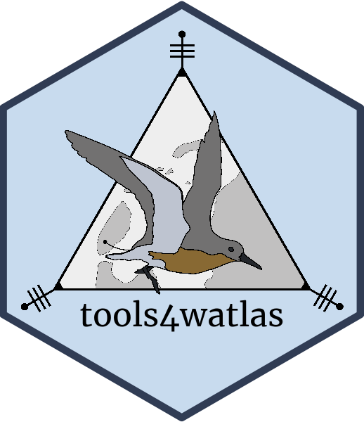
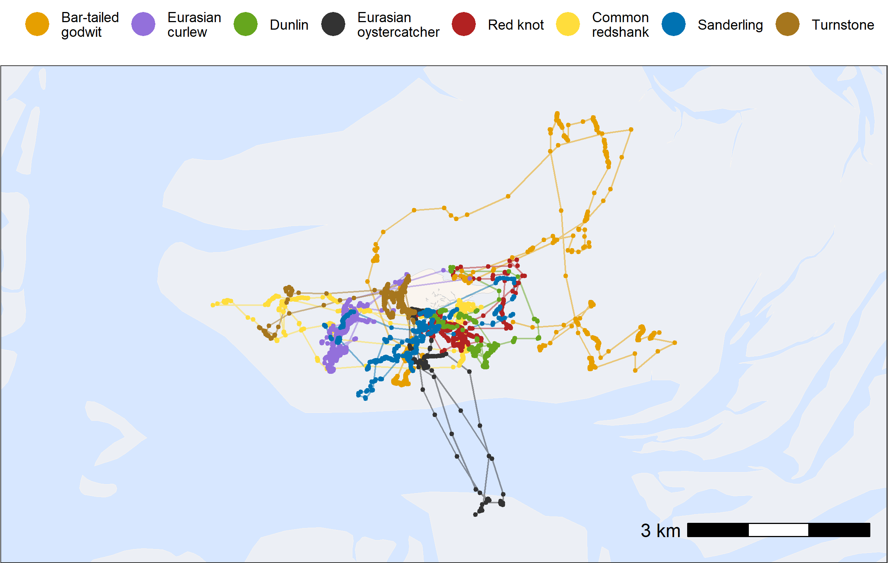
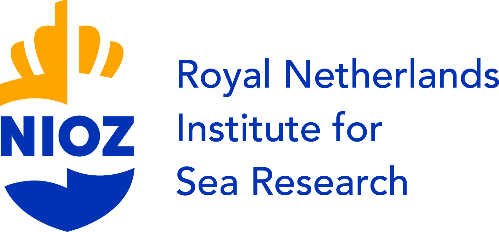

<!-- README.md is generated from README.Rmd. Please edit that file -->

# tools4watlas <a href="https://allertbijleveld.github.io/tools4watlas/"></a>

<!-- badges: start -->

[](https://www.repostatus.org/#active)
[](https://opensource.org/license/gpl-3-0)
[](https://github.com/allertbijleveld/tools4watlas/actions/workflows/R-CMD-check.yaml)
[](https://app.codecov.io/gh/allertbijleveld/tools4watlas)
[](https://joss.theoj.org/papers/fbe563e4d4b41e0d07c3b45a9a8d3507)
<!-- badges: end -->

Tools for processing and visualising high-throughput animal tracking
data, developed for WATLAS (Wadden Sea Advanced Tracking and
Localization of Animals in real-life Systems). For a background of the
system and associated research, see
[here](https://allertbijleveld.github.io/tools4watlas/articles/research_and_publications/research_and_publications.html)
or visit <https://www.nioz.nl/watlas> to follow tracked birds in real
time and to read the latest project news.

### Why `tools4watlas`?

`tools4watlas` was developed to:

- **Provide a consistent, reproducible workflow** for analysing WATLAS
  tracking data.
- **Simplify the basic workflow of
  [`atlastools`](https://github.com/pratikunterwegs/atlastools)**
  ([Gupte et al. 2021](https://doi.org/10.1111/1365-2656.13610)) to make
  handling of large data sets faster and more memory-efficient. See
  [Differences from
  `atlastools`](https://allertbijleveld.github.io/tools4watlas/articles/package_overview.html)
  for details.
- **Link tracking data to environmental data**, such as water level,
  bathymetry, sun and moon, or any other raster layer.
- **Plot and animate data** with easy to use base maps, functions and
  tutorials.

### Who is it for and how to use it?

`tools4watlas` is mainly developed for anyone working with WATLAS data.
However, Most functions only need coordinates (`x`, `y`), a timestamp
(`datetime`) and a `tag` ID, so the package can also be used with other
tracking data. The most likely user groups are:

- **Internal WATLAS data users:** All functions and workflows can be
  used, and the local files can be accessed via the network. See [Setup
  section](https://allertbijleveld.github.io/tools4watlas/articles/package_overview.html)
  for details and file paths.
- **External WATLAS data users:** Shared WATLAS data may already be
  pre-processed. Besides this, all functions can be used and we are
  happy to share environmental datasets on request.
- **Users of other ATLAS systems:** All basic functions can be used, but
  some are system-specific and may not be useful, such as the tidal and
  bathymetry data and the basemap function. For best results, we
  recommend forking the repository and adapting it to your system
  requirements. Basemap data can be replaced by following [Extract
  basemap
  data](https://allertbijleveld.github.io/tools4watlas/articles/package_development/extract_basemap_data.html),
  and `atl_add_raster_data()` works with any raster data.
- **GPS users:** The basic processing functions also work with GPS data,
  apart from the median smoothing. However, we recommend following the
  standard processing procedures of packages specialised in GPS data,
  such as [move2](https://bartk.gitlab.io/move2/index.html) or
  [amt](https://github.com/jmsigner/amt). The plotting and animation
  tutorials can still be useful, and for data from the Wadden Sea, the
  functions that link tracks to local environmental data can be useful
  as well.

**Feel free to reach out by [e-mail](mailto:allert.bijleveld@nioz.nl)
for questions or collaborations if you would like to work with WATLAS
data.**

### **Documentation**

The `tools4watlas` package is thoroughly documented on the [**official
package website**](https://allertbijleveld.github.io/tools4watlas/). See
[Package
overview](https://allertbijleveld.github.io/tools4watlas/articles/package_overview.html)
for a complete overview of articles. In short: The package articles
outline the **basic workflow** for working with WATLAS data, while
**extended workflows** guide through more specialized analyses.
Additionally, we provide **visualization tutorials** that demonstrate
various methods for plotting and animating the movement data. The
**package development** section offers insights into package maintenance
and how to contribute to the `tools4watlas` package.

### **Installation**

You can install the latest version of `tools4watlas` from
[GitHub](https://github.com/allertbijleveld/tools4watlas) with:

``` r
library(remotes)
install_github("allertbijleveld/tools4watlas")

# additional installs packages used in articles, but not needed by the package
install_github("allertbijleveld/tools4watlas", dependencies = TRUE)
```

### **Example data**

``` r
library(tools4watlas)
library(ggplot2)

# Load example data
data <- data_example

# Create base map
bm <- atl_create_bm(data, buffer = 800)

# Plot points and tracks
bm +
  geom_path(
    data = data, aes(x, y, colour = species),
    linewidth = 0.5, alpha = 0.5, show.legend = FALSE
  ) +
  geom_point(
    data = data, aes(x, y, color = species),
    size = 0.5, alpha = 0.5, show.legend = TRUE
  ) +
  scale_color_manual(
    values = atl_spec_cols(),
    labels = atl_spec_labs("multiline"),
    name = ""
  ) +
  guides(colour = guide_legend(
    nrow = 1, override.aes = list(size = 7, pch = 16, alpha = 1)
  )) +
  theme(
    legend.position = "top",
    legend.justification = "center",
    legend.key = element_blank(),
    legend.background = element_rect(fill = "transparent")
  )
```

<div class="figure" style="text-align: center">


<p class="caption">

Example tracks with one individual by species for two tide cycles
</p>

</div>

### **Work in progress**

More examples of workflows aimed at processing, plotting and adding
environmental data to WATLAS tracking data are being prepared. If you
have a request, please contact [Allert
Bijleveld](mailto:allert.bijleveld@nioz.nl).

We are working on the following articles at the moment:

- Connect WATLAS with SIBES data

### **Contribute**

If you want to contribute to `tools4watlas`
[fork](https://docs.github.com/en/pull-requests/collaborating-with-pull-requests/working-with-forks/fork-a-repo)
the repository on GitHub and then submit a [pull
request](https://docs.github.com/en/pull-requests/collaborating-with-pull-requests/proposing-changes-to-your-work-with-pull-requests/about-pull-requests).
Besides clear bug fixes, it is best to discuss potential changes or
additions with [Allert Bijleveld](mailto:allert.bijleveld@nioz.nl).
Check the article [Contributing to
tools4watlas](https://allertbijleveld.github.io/tools4watlas/articles/package_development/contributing_to_tools4watlas.html)
for more details.

### **Acknowledgements**

Many people and organisations are involved in developing and maintaining
WATLAS. We particularly thank Sivan Toledo and Ran Nathan for the
initial development of ATLAS, and Frank van Maarseveen and Bas Denissen
for the initial development of the Wadden Sea ATLAS (WATLAS).
Additionally, we thank Remko de Haan, Aris van der Vis, Yetzo de Hoo,
and NMF colleagues for further developments, assemblage and support.
Anne Dekinga is crucial for the field deployment and logistical
solutions. We thank our colleagues from COS for help catching birds,
especially Job ten Horn, Anne Dekinga, and Luc de Monte. Also, we thank
all partners and stakeholders for hosting equipment and for access to
their sites. Lastly, we thank the crews of the RV Wim Wolff and Wim-Jan
Boon of the RV Adriaen Coenen for their help in the field, Marten Tacoma
for visualizing the tracking data in real time on
<https://www.nioz.nl/watlas>, and the many other NIOZ staff and
volunteers that facilitated this work.

<p align="middle">

<a href="https://www.nioz.nl/en">

</a>
</p>
